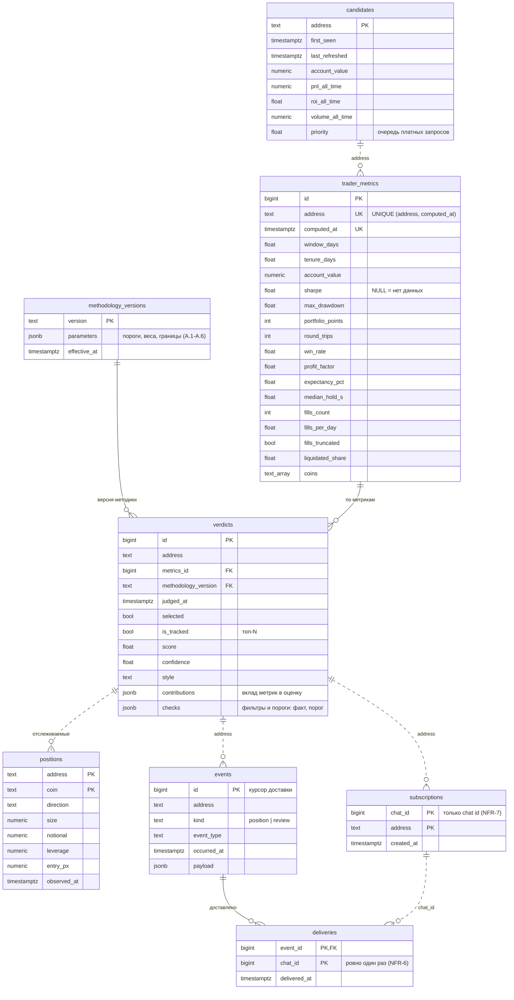

# Модель данных

Схема: [`src/hl_trader/storage/schema.sql`](../src/hl_trader/storage/schema.sql). Сплошные линии обозначают внешние ключи, пунктирные показывают связь по адресу трейдера или `chat_id` без внешнего ключа.

## Как читать

Отбор (FR-1...FR-8) идет через `candidates`, `trader_metrics` и `verdicts`. Метрики и вердикты только дописываются (NFR-4). При смене методики пересчет добавляет вердикты новой версии по тем же `metrics_id` и к бирже не обращается.

Для отслеживания (FR-9, FR-10) в `positions` хранится последнее состояние трейдеров с `is_tracked`. Каждое изменение позиции пишется в `events`, туда же попадает пересмотр вывода (`kind = review`).

Для доставки (FR-14...FR-16) `subscriptions` связывает чат с трейдером, а первичный ключ `deliveries` не дает отправить одно событие в один чат дважды.
